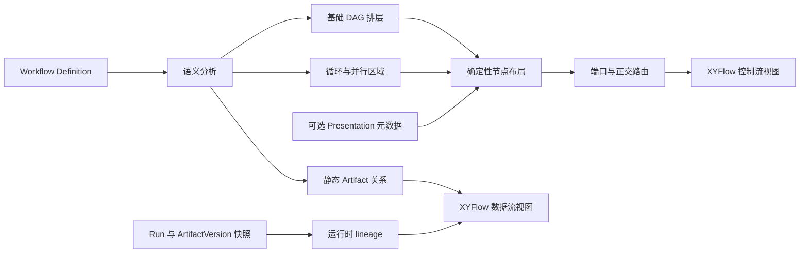

# 工作流流程图：循环、并行与数据流可视化设计

- 日期：2026-10-29
- 状态：分阶段实施中；0.1.33 覆盖定义编辑器，0.1.34 增加返工通道避让及 Run 产物绑定证据，完整 lineage 与高密度避障待后续阶段
- 设计基线：Multi-Agent Max `0.1.32`；首个实施版本 `0.1.33`
- 范围：Workflow Editor 的图布局、连线、语义展示与交互；不改变调度结果

本文是实施依据，并非现行产品需求的替代文件。其建议在实施前仍需用当时的代码与版本基线核对。

## 1. 目标与权威边界

当前编辑器可以保存并执行包含 `parallel`、`join`、`condition`、审核返工和有界循环的 Workflow Definition，但画布主要沿节点依赖从左到右排成若干列。用户很难一眼看出分支何时并行、何时汇合、返工回到哪里，以及 Artifact 在分支间如何传递。

本设计让用户在同一工作流中回答四个问题：

1. 主路径从哪里开始，哪些条件会选择其他路径？
2. 哪些节点能够并行，哪个 `join` 等待哪些分支？
3. 哪条边会回退，何时触发，最多往返几次？
4. 哪个节点生产 Artifact，谁消费它；这个关系是定义时可能成立，还是运行时已观测到？

产品语义以 [`final-reuse-integration-plan.md`](../../final-reuse-integration-plan.md) 和 [`MAM_REQUIREMENTS_DELTA_2026-07-27.md`](../../readme/MAM_REQUIREMENTS_DELTA_2026-07-27.md) 为准。`WorkflowNode`、`WorkflowEdge`、Artifact 契约、`WorkflowExecutionPlan`、Scheduler Kernel、Run/Task/Attempt 的权威状态保持原有职责。图中新增的分组、泳道、颜色、坐标和动画都只是解释已有定义的视图，不生成节点、边或调度事件。

## 2. 外部参照与可借鉴的机制

Archify 的 [Workflow 设计规则](https://github.com/tt-a1i/archify/blob/main/archify/renderers/workflow/README.md) 使用泳道表示责任或运行边界、阶段表示故事顺序、组表示分支或并行工作，并把等待、拒绝、重试放进例外泳道。它要求语义明确的边保留标签，优先使用外侧回路、底部通道等正交路由，并检查节点、标签和线段碰撞。其[工作流示例 JSON](https://github.com/tt-a1i/archify/blob/main/archify/examples/agent-tool-call.workflow.json)将 `mainPath`、`lanes`、`phases`、`groups`、`nodes` 和 `edges` 分开建模。

Archify 的[数据流示例](https://github.com/tt-a1i/archify/blob/main/archify/examples/product-analytics.dataflow.json)按 Source → Ingest → Process → Store → Consume 的阶段排列，给流动的**数据**命名，并将敏感流与派生流作不同视觉编码。其 [README](https://github.com/tt-a1i/archify#choose-the-right-diagram) 也将 Workflow、Data Flow、Lifecycle 分成不同图型：步骤顺序、数据流动和重试状态各有表达重点。

这里借鉴其表达原则和验证方法，保留项目现有的 `@xyflow/react` 编辑器。Archify 是面向生成和阅读的图表系统；直接换成其渲染器会丢失现有节点编辑、连线、Inspector 和保存链路，并使图表契约成为新的产品语义来源。

| 借鉴点 | 在 MAM 中的落点 |
| --- | --- |
| 主路径与例外路径分层 | 自动布局以无回退边的基础图排列，回退边走独立通道 |
| 泳道和分组 | 显式 `parallel`/`join` 生成可读的并行区域，审核返工区域单独标注 |
| 语义边标签 | `when`、`maxTraversals`、分支目标和 Artifact 标识直接可见 |
| 数据流独立表达 | 同一节点集提供控制流、数据流两个视图；数据流不伪装成调度边 |
| 画面质量检查 | 对节点重叠、线穿节点、标签遮挡、回路混淆建立可复现验收 |

## 3. 现状与故障机制

| 位置 | 当前机制 | 结果 |
| --- | --- | --- |
| `src/renderer/src/features/mam/mam-workflow-canvas-model.ts` | 使用入度为零的队列算层级，按层编号分配 `x = rank × 240`、`y = row × 140` | 回退边参与入度计算。一个强连通区域的节点无法入队，仍留在默认 rank 0；复杂循环容易挤在左侧 |
| 同上 | 同一层的纵向顺序来自定义数组顺序 | 并行分支与对应 `join` 的关系没有稳定视觉结构；新节点顺序变化会改变排布 |
| 同上 | 所有边统一 `smoothstep`，标签只显示 `when` | 返工线可能穿过主链；有界次数、边的角色和数据含义不直观 |
| `MamWorkflowCanvasNode.tsx` | 同一矩形卡片和左右两个 Handle，仅展示 ID 与原始节点类型 | 条件、分叉、汇合、人工门禁和结束状态难以快速区分；回退线也只能从右向左绕行 |
| `MamWorkflowEditor.tsx` | 连接、移动和删除分别操作 React Flow 本地状态与定义状态 | 增加自动重排和新连线样式时，必须先收敛同步边界，避免视觉边与保存数据不一致 |
| `src/shared/mam/domain/workflow.ts` | `WorkflowEdge` 只有 `from`、`to`、`when?`、`maxTraversals?` | 现有边是**控制依赖**，没有独立的数据流边；不能据此声称已实际传输 Artifact |

`src/main/mam/workflow/workflow-graph-analysis.ts` 已将带 `maxTraversals` 的边从基础 DAG 中剔除，并要求它们返回到拓扑序中更早的节点。布局应复用同一语义边界：基础 DAG 决定主要阅读方向，有界边决定返工回路。不能把所有成环边简单隐藏后假定剩余图有效；应复用或等价执行编译器检查。

## 4. 方案选择

| 方案 | 好处 | 代价 | 结论 |
| --- | --- | --- | --- |
| 保留 XYFlow，增加语义分析、分层布局与定制边 | 复用现有编辑器；逐步上线；可以直接标出 MAM 控制和 Artifact 语义 | 需要自行实现布局和避障检查 | **采用** |
| 引入通用 DAG 自动布局（例如 Dagre/ELK）作为唯一算法 | 简单 DAG 排版实现快 | 有界回路、固定端口和并行区域仍需自定义；对复杂图可能产生难解释的回路线 | 可作为内部候选布局器，不作为产品契约 |
| 将 Archify HTML 嵌入编辑器或替换现有画布 | 阅读图可能很精美 | 编辑、Schema、状态同步和主题需重做，难与既有 Inspector 保持一致 | 不采用 |

图必须先准确表达控制依赖，然后表达可能的 Artifact 关系。美观性在语义正确和稳定布局之后优化。

## 5. 用户可见的图语言

### 5.1 控制流视图

- 阅读方向固定为从左到右。基础 DAG 的入口、处理、门禁、汇合、结束分别占不同阶段。多个同层节点上下排列，不把“上下”解释为严格时间先后。
- `parallel` 画成分叉节点；各分支位于独立行，配套 `join` 画成汇合节点。分支区上方显示“并行”，`join` 附近显示实际 `waitFor` 列表。只有显式引用能证明配套关系时才画完整分组；模糊或交叉分支保留分叉线，不臆造共同边界。
- `condition` 的每条已定义分支展示分支键或 `when`。未命名、相互冲突或引用缺失的分支给出诊断，不替用户补充判断结果。
- 带 `maxTraversals` 的边沿图上方或下方的返工通道返回较早节点；显示“`when` · 最多 N 次”。当 `when` 缺失时只显示“最多 N 次”，不能写成“审核不通过”。与前进边共端点时使用不同 Handle 或端口偏移。
- `human_review_gate` 的 `changes_requested` 回边、`review_gate`/`review_aggregate` 的返工边、普通有界回边都按实际边数据表达。人工沟通和自动返工含义从节点类型与权威语义获得，不靠颜色推断。
- `approval_gate`、`human_review_gate`、`finish` 使用可识别的图标、标题和辅助文字；节点卡片显示固定 Role 的**显示名**或稳定 ID，不能把 Role 名称硬编码成固定角色类别。
- 主路径只在存在明确定义时强调。首期可将入口至结束的一条确定性基础路径作为“阅读路径”，并标注“阅读路径”；它不表示其他分支不执行。用户选择节点或边后可高亮实际有向上游/下游。路径遍历必须用 visited 集合防止循环无限展开。

### 5.2 数据流视图

数据流视图与控制流视图使用相同节点和图坐标，切换时不重新保存坐标。控制依赖边淡化，Artifact 关系以另一个线型或颜色出现，并在视图标题中明确标“定义时可能的数据关系”或“本次 Run 已记录的 Artifact 流”。两种状态不能混成一条无法区分的线。

定义层按以下确定性规则建立候选关系：

1. 从节点的 `outputs`、`planContract`、`reportContract` 取得 `artifactType`，从消费节点的 `inputs[]` 取得 `artifactId`。沿**基础 DAG 的祖先**查找同名生产者；仅按现有编译器使用的名称约定匹配。
2. 若生产者唯一，画一条虚线，标签为 Artifact ID 与“可能提供”；在 Inspector 中展示输入引用的版本与内容 Hash。若有多个可能生产者，列出候选并标“来源未确定”，不能任选一个画成事实。候选多来源时可显示汇总关系标记，但不得把它落在某一个生产节点上。
3. 若无匹配生产者，但输入来自 Run 初始 Artifact，则显示画布边缘的“初始输入”入口；若两者都不满足，沿用编译错误，不画凭空来源。
4. `parallel`、`join`、`condition` 本身不自动生产 Artifact；不能因为控制边相连就声称数据流过它们。跨分支消费只在引用或运行证据支持时出现。
5. 本次 Run 视图只使用已保存的 ArtifactVersion `nodeRunId`、`inputs` lineage、输出绑定和相应快照。`nodeRunId` 必须经 Run 的 NodeRun 表映射到定义节点 ID；不能通过 Artifact ID 或类型相同就推出生产者。无法稳定映射时，退回“来源未确定”，不将推测显示成观测事实。

在定义与运行状态之间必须明确区分：定义时“可能提供”表达静态契约；运行时“已记录”表达不可变记录。图像动画只能跟随这些已知关系，不假装观察到 Agent 内部的数据传输。

### 5.3 视觉层级与交互

- 使用 [`docs/STYLEGUIDE.md`](../../STYLEGUIDE.md) 的现有 token、`lucide-react` 图标和 shadcn 控件。节点类型用图标、文本、边框或背景共同区分，颜色不是唯一语义。暗色、亮色、缩放和 `prefers-reduced-motion` 都须可读。
- 正常前进边为实线；条件边带标签；返工边带明确箭头、次数和回路样式；候选数据边为虚线；运行事实数据边为实线但使用独立图例。选中某条关系时突出相关节点与边，其他内容降低对比但仍可见。
- 首屏展示控制流和最小图例。工具栏提供“控制流 / 数据流”切换、“自动整理”和“适合画布”；图例、视图状态、错误提示应保留在画布或 Inspector 中，而非隐藏在 tooltip。
- 点击节点打开现有节点 Inspector；点击控制边打开边 Inspector；点击 Artifact 关系打开只读数据关系面板。键盘可聚焦节点和边，选择后的可见说明与鼠标一致。
- 同时提供整体视图和局部追踪：节点的“看上游 / 看下游”仅遍历定义中的关系；数据视图的追踪只遍历当前显示的数据关系。有限循环始终在首次重复节点处停止，并显示回路标记。

## 6. 技术结构



建议按职责拆分，不再把算法和编辑动作全部塞进现有 canvas model：

| 单元 | 输入 → 输出 | 职责 |
| --- | --- | --- |
| `mam-workflow-visual-analysis.ts` | Definition → 基础图、回退边、拓扑层、强连通区域、分支关系、诊断 | 只分析语义，不能改定义；与编译器对于有界边和节点引用的解释保持一致 |
| `mam-workflow-layout.ts` | 分析结果 + 手动固定坐标 → 节点矩形、区域矩形 | 稳定排序、避开重叠、容纳多分支及循环区域 |
| `mam-workflow-edge-routing.ts` | 布局 + 控制边 → 端口、正交折线、标签锚点 | 为前进、条件、回退边分配通道，报告交叉或遮挡 |
| `mam-workflow-artifact-relations.ts` | Definition + 可选运行快照 → 候选/已记录关系 | 区分静态推断与运行证据；不写入 WorkflowEdge |
| `MamWorkflowCanvasNode.tsx` 与定制 Edge | 上述只读模型 → React 组件 | 节点、边、图例与选择高亮 |
| `MamWorkflowEditor.tsx` | 编辑命令 → 唯一草稿状态 | 保持保存的 Definition 与显示图同步，提供视图切换和自动整理 |

命名是建议；实施时可根据文件长度拆分，但不能出现 `helpers`、`utils`、`common` 等模糊模块名，也不能提高 max-lines 规则。

### 6.1 语义分析与自动布局

1. 用当前 Definition 建立有向图。定义基础边为 `maxTraversals === undefined`，回退边为 `maxTraversals !== undefined`。先运行当前 Schema 与 Compiler 的校验；校验失败时仍可展示可用节点，但诊断不能被自动布局掩盖，保存仍遵循现有门禁。
2. 对基础图做稳定拓扑排序与最长路径排层。多入口或断开图仅供编辑中的草稿定位；不得展示为已验证工作流。排序优先使用节点 ID；定义数组下标只用于 ID 缺失等无效草稿的最后兜底，避免有效图因节点数组重排而漂移。
3. 对完整图计算强连通分量，标出回路相关节点，并逐条保留原始有界边。强连通分量只用于分配回路空间；循环次数属于边，不属于分量。多个共享节点的回路可能位于同一视觉区域，但各自标签保持独立。
4. 以显式 `parallel.branches` 和 `join.waitFor` 为锚点识别并行区。只有每条分支都能在基础图中到达同一 `join`，且不会使区域重叠或把不相关节点误包进去，才画封闭区域；否则画分叉和汇合节点并提示“无法确定唯一并行区域”。
5. 先按基础层生成左右列；并行分支上下排布，合并点对齐分支中心；再给上下方的返工通道预留空间。不要为了缩短一条回边把前进主链折回左侧。
6. 自动布局应当是纯函数，同一 Definition、Presentation 和布局算法版本得到相同坐标。对拖动固定的节点先尊重其位置；若与新增节点冲突，仅移动未固定节点。若固定节点彼此碰撞，报告可见冲突并提供“重新整理”，不能悄悄改动用户固定的坐标。

`O(V + E)` 的拓扑和强连通分析可处理大图；实际排布与路由需设置可测的上限。目标是在常见 10–40 节点图上交互顺畅，100 节点图仍能打开并选择节点。超出可读规模时提供定位与局部高亮，不以缩到无法阅读来“适合画布”。具体时间阈值应在目标 macOS 门禁机器上测量，不能由本机 Windows 结果推定。

### 6.2 路由和标签

- 前进边优先从右侧输出端口到左侧输入端口；同一节点多边按目标纵向顺序分散端口。纵向相邻分支可使用上/下端口，但选择规则须确定。
- 回退边优先从源节点上/下端口走专用通道到目标节点上/下端口。不同回退边按跨度与稳定 ID 分配通道，禁止多条不相关边长距离重合或在同一个箭头上叠加。
- 正交线应绕过非端点节点。边标签优先放在长水平段；为标签预留背景和间距，避免遮住箭头、节点标题或另一标签。空间不足时可将完整标签固定到选中详情，同时在画布保留可识别的短标签和可见截断标记。
- 条件分支、审核结果与回退上限使用真实 `when`/`maxTraversals`；缺失值不能猜。对平行的往返边，箭头方向始终明显。
- 数据边单独路由，并能隐藏控制边。不能让两类线共用无法区分的样式或同一个选择 ID。

### 6.3 Presentation 元数据与兼容性

采用可选的展示字段，随 Workflow Definition 版本保存。建议形态：

```ts
type WorkflowPresentation = {
  schemaVersion: 1
  pinnedPositions?: Record<string, { x: number; y: number }>
}

// WorkflowDefinition 可选增加：presentation?: WorkflowPresentation
```

只保存**手动拖动**后固定的节点；未固定节点每次按确定性算法排布。`pinnedPositions` 只接受当前节点 ID、有限数值与合理画布边界；节点改名时同步改键，删除时清理。缩放、平移、当前选中、视图切换和临时高亮保持本地 UI 状态，不进入 Definition。选择“自动整理”会清除本版本的固定位置并重算；用户保存后，这一呈现变更随新定义版本保留。

当前 `WorkflowDefinitionSchema` 是 strict；新增字段要同时更新解析、Workflow Package 导入导出、Catalog 保存和 Design Assistant 的定义生成/复用链路。旧定义无 `presentation` 时保持可读。**旧版应用无法解析含新字段的定义**，因此跨 clone 升级需要同版本门禁与兼容性测试。若完整 Definition 有内容摘要，也需明确其摘要变化；`compileWorkflow` 当前基于节点、边和运行限额构造 `planHash`，应验证仅改变 `presentation` 时 `planHash` 不变。Presentation 不得进入 `WorkflowExecutionPlan`、Run 的调度判断或权威事件。

Workflow Definition 已按版本管理。保存仅展示坐标也会创建定义新版本，旧 Run 固定旧定义；UI 必须说明这是一版工作流呈现改动。若后续认为坐标变化不该产生定义版本，可再设计独立展示资源，本期不引入第二套持久化来源。

### 6.4 编辑一致性

目前 `definition`、React Flow `nodes` 和 `edges` 分别持有状态。实施时以 Definition 草稿加 Presentation 为唯一可保存状态；React Flow 节点与边是从它们导出的视图。拖动只更新 `pinnedPositions`，连线、改名、删边等先修改 Definition，再重新导出画布模型。特别需要保持以下原子性：

- 连接 `human_review_gate` 自动创建返工边时，控制边、`revisionTargetNodeId` 和呈现边要同次更新。
- 重命名节点时同时更新 `parallel.branches`、`join.waitFor`、`condition.branches`、返工目标、边端点和位置键。
- 删除节点时清除相关边、固定位置和失效的选择；显示现有编译错误，不能自动篡改其他节点的业务配置。
- 边编辑或删除按稳定的逻辑键定位。现有 `from:to:index` ID 与删除过滤耦合，加入不同视图后应避免索引变化误删其他边。
- 视图切换、局部高亮、自动布局预览不更改 Definition；确认“自动整理”会清除 Presentation 的固定坐标，属于可保存的展示改动。保存前校验 Definition 与 Presentation。

## 7. 错误与降级行为

| 情况 | 画布行为 | 保存行为 |
| --- | --- | --- |
| 无界循环或错误回退方向 | 显示原始边及错误标记，不据此推导正常主路径 | 保持现有 Compiler 拒绝 |
| `parallel`/`join` 引用不一致 | 展示真实分叉与连线，关闭不可靠的并行区域框 | 保持现有 Compiler 拒绝 |
| 多个可能的 Artifact 生产者 | 标记多来源，Inspector 列出候选，不画“已流动”事实 | 按现有业务校验处理；视觉层不改变有效性 |
| 手动固定位置相互遮挡 | 显示碰撞诊断和“自动整理”操作 | 坐标校验失败时拒绝保存展示元数据；业务定义校验仍独立 |
| 节点太多或标签过长 | 保持最低可读缩放，支持搜索和局部追踪；标签在详情中完整显示 | 不因渲染拥挤改变工作流语义 |
| 运行时 Artifact lineage 缺失 | 只展示定义层候选关系并明确标注 | 不补造运行记录 |

## 8. 验证和验收

### 8.1 自动检查

1. 纯函数测试：无边、线性、菱形条件、2–4 并行分支、嵌套并行、单回路、共享节点多回路、审核返工、交叉依赖、断开草稿。确认布局确定、节点不重叠、所有回退线仍保留及标签一致。
2. 属性/夹具测试：随机重排有效定义的节点数组不应改变基于 ID 的视觉拓扑；对同一输入重复布局得到相同结果；重命名、删除、连线和编辑后视图与保存 Definition 一致。
3. 语义测试：Presentation 增删或拖动不改变 `planHash`、基础图依赖和 Scheduler 结果；Artifact 静态匹配对多生产者不能误报唯一来源；运行数据只连接有实际 lineage 的节点。
4. 路由检查：节点或标签不能被非端点边穿过，回退线箭头不与前进线叠加，条件/次数标签不遮挡；困难场景允许产生显式诊断，不能静默输出误导画面。
5. 兼容测试：无 Presentation 的旧 Definition 与 Workflow Package 可打开、导入、导出；含 Presentation 的新版本在同版本 clone 中可往返；旧 Run 不因展示字段改变。
6. 桌面交互测试：切换控制/数据视图、拖拽、自动整理、节点/边 Inspector、键盘选择、暗亮主题、缩放和 reduced motion。执行仓库既有 lint、typecheck、build 与必要的 targeted tests。

### 8.2 人工验收场景

至少准备三份由当前 Schema/Compiler 验证通过的真实工作流定义：

- **交付审核返工**：`role_task → review_gate → git_merge → finish`，`changes_requested` 从审核回到原任务，最大两次。首屏能在 5 秒内找到回退目标、条件和次数。
- **并行生产与汇合**：一个 `parallel` 分出至少三支，各自产出不同 Artifact，`join` 等待三支；控制流图一眼能看到并行边界，数据流图能指出各 Artifact 的来源与消费方。
- **条件加交叉数据**：条件分支与并行区相邻，某消费节点引用多个来源候选。画布必须标“来源未确定”，不得画成运行事实；运行快照加入确切 lineage 后能看到“已记录”关系。

验收时让没有参与实现的人仅看图回答第 1 节四个问题，记录答案和耗时。视觉正确性以真实 Definition/Run 数据与答案一致为准，不能仅凭截图“好看”判定。

## 9. 实施顺序与交付物

1. **语义模型**：提取纯分析函数和静态/运行时 Artifact 投影；用编译器测试夹具锁定控制语义。
2. **自动布局**：基础 DAG 排层、并行区域、强连通区域和回退通道；先保证确定性和无重叠。
3. **连线与节点表达**：自定义端口、正交回路、标签、节点图标和图例；完成暗亮主题与可访问性。
4. **编辑器状态收敛**：Definition 作为唯一可保存草稿，接入拖动固定位置、自动整理、视图切换和 Inspector。
5. **Presentation 持久化**：更新 Schema、Catalog、Package、Design Assistant 及兼容性测试，验证 `planHash` 不变。
6. **桌面验收**：以上三种场景的截图或录屏、交互检查、性能与可读性记录。修改运行时代码时按 `AGENTS.md` 增加 `package.json` patch 版本并创建对应版本档案。

0.1.33 已实施定义编辑器中的基础 DAG 布局、并行区域、有界返工显示、静态产物关系视图、固定坐标与路径追踪。0.1.34 继续加入按节点位置分配的返工通道，以及 Run 详情中由当前正式交付 claim 与固定输入引用核对得到的只读证据；该证据不证明执行器实际读取。完整的 ArtifactVersion lineage、密集图全局避障路由及 macOS 实机视觉验收仍属于后续实施与验收范围。后续实现应按每步单独验证，并在现行产品权威与版本记录规则下提交。
